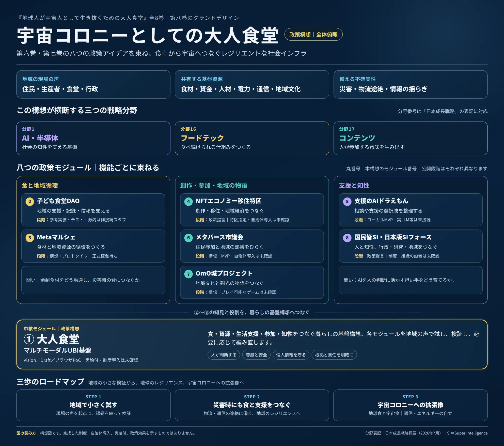

<p align="center">
  
</p>

# 大人食堂（マルチモーダルUBI基盤）政策ゲーム

**OtonaShokudo-UbiPolicy-RPG** — 食卓から始める、政策形成の「人生ロープレ」構想

  

> 「人生ゲームの途中で地球が引っくり返ったら、誰が勝ち？ 全員、負け？」
> それ、つまんない。皆んなでルールを創り直そう。

## このゲームで考えること

構想が壮大であるほど、出発点は身近な食に。食が脅かされる事態に備え、老若男女、私たちの食卓を守るには何ができるのか。本リポジトリは、『地球人が宇宙人として生き抜くための大人食堂』全8巻の構想を、政策形成を学ぶためのPython製コマンドライン・ゲーム案にしたものです。

第六巻では、現場の困り事を政策の問いに変え、技術モックや政策MVPをつくりながら、その政策が役に立つかを人が確かめる「政策FDE」の考え方を示しました。[1] 第七巻の公開記事では、八つの政策構想を人生ゲームのクエストへ移し、若い世代と一緒にルールを書き換える構想を描いています。[2] ここでいう「新ぎゅらりふぃー」「ぎゅらりふぃー」は筆者の提案する親しみを込めた呼び名で、世代を区切る学術用語ではありません。[2]

本作は、現場の声を読み、限られた資源のなかで行動を選び、見落とした声と次の検証課題を振り返る試作品です。自治体での導入、制度の実施、実給付、政策効果を示すものではありません。ゲーム内の人物・出来事・資源量・効果は架空または説明用の仮定です。

## 政策FDEの考え方

FDEは Forward Deployed Engineer（前線配備エンジニア）の略です。「政策FDE」は、地方などの現場に入り、困り事を政策の問いへ移し、技術モックや政策MVPを通じて社会課題の解決を目指すために筆者が提案する呼称です。公的な資格や制度上の職名を示すものではありません。[1]

AIには、検証の整理、要件の下書き、画面案、コード、テストなどを手伝ってもらう。一方で、問題の本質を見極め、その政策が役に立つかを最後に判断するのは人です。厨房にたとえるなら、AIに下ごしらえを任せても、味見と検証は人が担う。試作品を世に出す前に確かめ、実装範囲、未接続、未実装をREADMEに明記します。

## 八つの政策構想

下表は、第六巻の公開記事に記載された構想・公開物の説明を整理したものです。記事は、全コードの再実行や自治体導入・政策効果の独自評価を行った一覧ではないと明記しています。したがって、ここでの段階表示も記事に記された範囲の整理であり、本リポジトリが各構想を実装・実証したという意味ではありません。[1]

| 政策構想 | このゲームで考えること | 第六巻に記された公開物・確認範囲 |
| --- | --- | --- |
| ① 大人食堂（マルチモーダルUBI基盤） | 食、生活支援、地域循環、仮定を置いた試算 | Vision、KPI・実証計画Draft、ブラウザPoC。実給付・実LLM・自治体実証は未実施。 |
| ② 子ども食堂DAO | 「今日の一食」、支援・資金の流れの見える化 | 参考実装・テスト、非査読ワーキングペーパー・政策ブリーフ。World IDはモック、ガバメントAI「源内」は非接続スタブ。 |
| ③ Metaマルシェ | 食材と地域資源の循環、リアルとWebの接続 | 本人ページ上のprototype／正式稼働待ち。関連OSSは実市場の稼働を示すものではありません。 |
| ④ NFTエコノミー移住特区 | 創作・移住・起業と地域経済 | 政策提言。特区指定・自治体導入は未確認で、特区固有のMVPは未作成。 |
| ⑤ 支援のAIドラえもん | 相談・支援の選択肢を整理し、人が確認する | ローカルMVP。ルールベースCopilot、配分案、簡易台帳。実LLM・本番本人確認・実給付・自治体実証は未接続・未実証。 |
| ⑥ メタバース市議会 | 参加の入口を広げ、住民の熟議を支える | 2021年の構想記事。手段は見直し中で、自治体導入は未確認。 |
| ⑦ OmO城プロジェクト | 地域文化・物語・観光と暮らしをつなぐ | 構想記事・後続の言及。プレイ可能なゲーム、固有MVP、公式運用は未確認。 |
| ⑧ 国民皆SI・日本版SIフォース | 知性・行政・研究・地域の連携 | 政策提言。制度・組織の設置は未実施。政府職員向け公式「源内」とは別構想。 |

「源内は非接続スタブ」とは、本プロジェクトの試作物が本番の政府環境に接続していないという意味です。公開OSSを参照することと、政府環境の権限・安全要件を満たして接続することは別です。構想、仕様、コード、モック、スタブを、完成済みの政策パッケージと取り違えないようにします。[1]

## 第七巻のクエスト案と、現在のCLI版

第七巻の記事は、架空の「大人食堂ワールド」で、市民・生産者・運営者・行政・政策FDEの役を交代し、イベントカードに向き合うゲームを提案しています。サイコロで政策を決めるのでなく、選んだ理由を振り返り、次の社会課題を持ち帰るという構想です。[2]

第七巻の記事では、各クエストの優勝条件に、大人食堂の関与者からの「有り難う！」の数を競う案も示されています。[2] 一方、現在公開しているPython CLI版は、勝敗・順位・競争ルールを実装していません。表示する「有り難う！」は、行動カードのタグとイベントの困りごとタグが対応した記録数から、AI提案の味見省略分を差し引くゲーム内の仮想指標です。実際の感謝、満足度、同意、政策効果を測るものではありません。この説明では、第七巻の記事のクエスト案と、現行ソフトウェアの仕様を分けています。

現行CLIでは、食材・予算・人手・電力／通信の限られた資源を使います。ラウンドごとに住民・生産者・運営者・行政・技術者（政策FDE）の視点が巡り、最大2つの行動を選びます。最初のイベントは「世界大恐慌」です。異論、担当パス、途中離脱ができます。AI行動は固定の行動カードで、実際のAIモデルや外部サービスには接続しません。

| 入力 | できること |
| --- | --- |
| `1 4` | 番号で行動を選ぶ。Enterだけで見送り。 |
| `d` / `m` / `s` | 行動の説明／八構想の段階／いまの状態を見る。 |
| `o` | 異論・違和感を記録する。 |
| `p` | 今回の担当をパスする。担当者名・理由はレポートに保存しません。 |
| `q` | 途中で抜け、そこまでの振り返りを見る。 |

標準設定は6ラウンド、`--quick` は3ラウンドです。`--seed` を使うと同じ標準イベント順を再現でき、ゲーム後には再戦コマンドが表示されます。複数人で遊ぶ場合はニックネームを使ってください。

## すぐに遊ぶ

公開中のGitHubリポジトリから取得できます。Python 3.10以上が必要で、実行時の追加ライブラリはありません。

```bash
git clone https://github.com/SunVerdir/OtonaShokudo-UbiPolicy-RPG.git
cd OtonaShokudo-UbiPolicy-RPG
python -m pip install -e .

# ひとりで遊ぶ
otona-shokudo-rpg --seed 7

# 短く試す（3ラウンド）
otona-shokudo-rpg --quick --seed 7

# 交代で担当する（複数人）
otona-shokudo-rpg --players ゆい,そら,はる

# 入力なしのデモ
otona-shokudo-rpg --demo --seed 7

# 振り返りをMarkdownで保存
otona-shokudo-rpg --seed 7 --save-report game-report.md
```

インストールせずに試す場合：

```bash
PYTHONPATH=src python -m otona_shokudo_rpg --demo --seed 7
```

## 安全とプライバシー

この版はローカルで動くコマンドライン試作品です。ブラウザ版、自治体システム連携、実際の給付・支援、外部AIモデル接続はありません。ゲーム内容を外部ネットワークへ送信する機能もありません。

プレイヤー名、選択理由、異論、振り返りの記憶は、入力した場合、ゲームの実行中や保存レポートに含まれます。`p`を選んだラウンドは担当者名と理由をレポートに保存しませんが、画面には担当名が一時表示され、役割・イベント・結果は記録されます。実在の氏名、連絡先、健康・家庭状況など、個人を特定できる情報を入力しないでください。保存レポートを共有する前に自由記述を確認してください。

AIの提案や資源配分は、参加者が確かめるための学習用ルールです。政策効果や行政判断の代替ではありません。人の尊厳をゲーム化せず、異論を述べる権利と途中離脱の自由を守ります。

## 画像・動画

<p align="center">
  <br>
  <sub>政策構想の全体俯瞰図。制度の実施状況や政策効果を示すものではありません。</sub>
</p>

<p align="center">
  <br>
  <sub>生成AIによる構想イメージ。架空の人物・施設・場面であり、実在の施設や実現済み制度を示しません。</sub>
</p>

[紹介動画をYouTubeで開く](https://www.youtube.com/watch?v=ytwcI6eXzXA)。動画説明欄の章立ては「大人食堂／Metaマルシェ／食・SI基盤・UBI・政策〔メタ安全保障〕／多次元経営論」です。ここでは映像の場面を要約・描写していません。本リンクは参考資料であり、本リポジトリのゲーム実演として掲載するものではありません。

## ルールの提案と開発状況

行動カード、イベント、役割、資源、検証課題は`src/otona_shokudo_rpg/data/`以下のJSONで管理しています。複製・編集したルールは、整合性チェックを実行できます。

```bash
cp -r src/otona_shokudo_rpg/data my-rules
otona-shokudo-rpg --rules my-rules --check-rules
otona-shokudo-rpg --rules my-rules
```

テストとルール検査：

```bash
PYTHONPATH=src python -m unittest discover -s tests -v
PYTHONPATH=src python -m otona_shokudo_rpg --check-rules
```

- [x] v0.2.1 コマンドライン版（1〜5人、ショート周回、再戦、デモBot、振り返り）
- [ ] 紙のカード版・ワークショップ用シート
- [ ] ブラウザ版
- [ ] 第八巻「宇宙コロニーとしての大人食堂」拡張パック（電力・通信・地球食と宇宙食）

α世代・Z世代の実際の参加者によるプレイテストは未実施です。遊びやすさや楽しさは、任意参加のテストで確かめます。

## 参考資料

[1]は第六巻、[2]は第七巻の公開記事、[3]は全8巻のマガジンです。

[1]: https://note.com/society/n/ne7d3ff56943f "第六巻｜政策FDE――AI駆動開発で「食と命」の未来を試行する"
[2]: https://note.com/society/n/nf07fef47ae7e "第七巻｜多次元経営と人生ゲーム――新ぎゅらりふぃーの小噺も交え、人々が参加する意味創造、物語を考える"
[3]: https://note.com/society/m/mcd036ce330be "全8巻マガジン"

## ライセンスとAI利用

Python実装（`src/otona_shokudo_rpg/*.py`）、テスト、プロジェクト設定はMITです。README・Vision・貢献／公開手順・変更履歴・設計文書・ルールJSON・同梱画像はCC BY 4.0です。適用範囲と帰属表示は[`ATTRIBUTION.md`](ATTRIBUTION.md)、ライセンス原文は[`LICENSE-MIT`](LICENSE-MIT)および[`LICENSE-CC-BY-4.0.txt`](LICENSE-CC-BY-4.0.txt)を参照してください。ファイルごとにライセンスが異なるため、`pyproject.toml`には単一のパッケージ全体ライセンスを設定していません。GitHubの自動判定表示だけで全ファイルの適用範囲を判断しないでください。YouTube動画とリモート表示のサムネイルは、これらのライセンスの対象外です。

企画整理、コード、テスト、文書の下書きに生成AIの支援を利用しています。ゲーム内に実LLMへの接続はなく、外部サービスへの自動送信機能もありません。最終的な内容と公開判断は、公開者が確認します。
